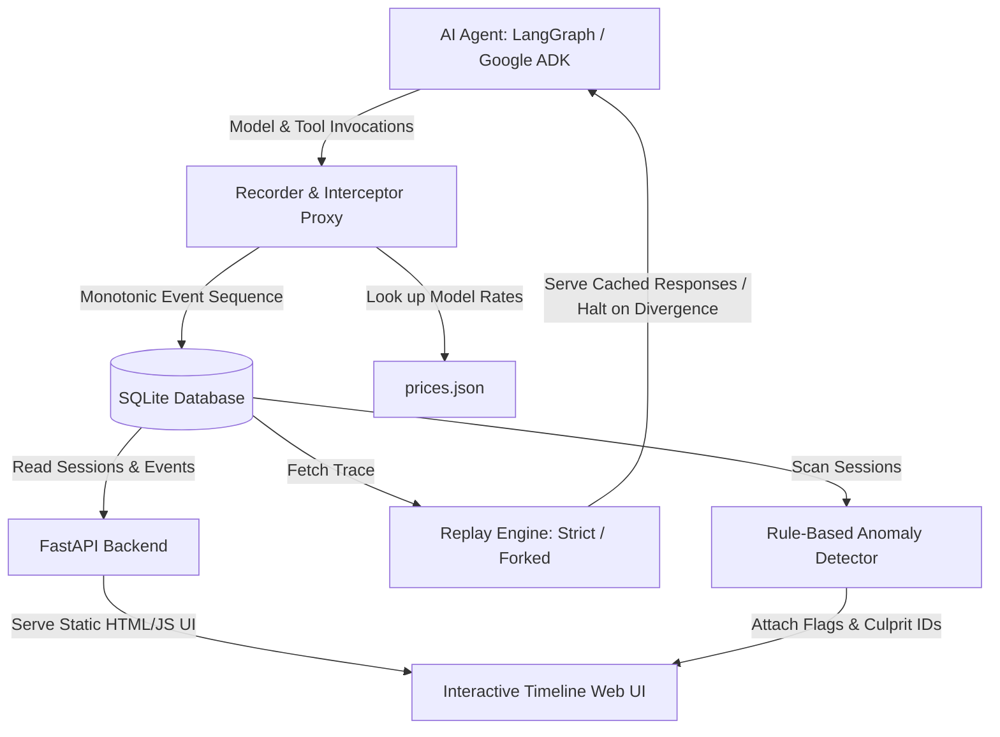

# ⚡ CS26048-AgentReplay

> **A logging proxy, observability timeline, and deterministic replay engine for AI agent tool and model calls.**

Developed as the practical implementation of **Project Proposal (24CS061)**.

## Project Documents

- [Problem Statement](docs/Problem-Statement.md)
- [Literature Survey](docs/Literature-Survey.md)
- [Project Timeline](docs/Project-Timeline.md)
- [Requirements](docs/Requirements.md)
- [Project Proposal](docs/PROPOSAL.md)
- [Architecture and implementation decisions](docs/DECISIONS.md)

---

## 🎯 The Problem

When conventional software fails, developers can attach debuggers, inspect stack traces, and step through execution lines. But in autonomous AI agents, the execution path is generated at runtime by stochastic LLMs and disappears after the request finishes. 

When an agent loops on a tool, quiet-fails after a malformed payload, or hallucinates an unexpected parameter, reproducing the issue is notoriously unreliable. Re-running the agent incurs network delays and API billing, and often takes an entirely different path.

`agent-replay` solves this gap:
1. **Records** every tool call and model call with timestamps, parameters, return values, token usage, and calculated cost.
2. **Reconstructs** sessions as an interactive, chronologically ordered visual timeline.
3. **Replays** past sessions **stochastically-free and with $0 API cost** by serving stored responses from SQLite.
4. **Forks** executions by substituting a recorded response at step $k$, allowing developers to observe how downstream model calls adapt to modified states.
5. **Detects** statistical irregularities (loops, cost spikes, runaway durations) with transparent, explainable rule-based detectors.

---

## 🏗️ Architecture



Model-call replay is implemented and validated for explicit model wrappers (the ADK-style loop). For LangGraph, model calls are recorded for audit/cost tracking but the live model is still called during replay; LangGraph model-call substitution is a known limitation, listed in Future Work.

---

## 📊 Core Data Schema

All interactions are captured in SQLite under the `events` table:

| Field | Type | Description |
| :--- | :--- | :--- |
| `session_id` | TEXT | Unique identifier grouping session events |
| `seq` | INTEGER | Monotonically increasing execution counter (1, 2, 3...) |
| `type` | TEXT | Event classification: `'tool_call'` or `'model_call'` |
| `name` | TEXT | Identifier (e.g. `search_docs`, `gemini-1.5-flash`) |
| `args_json` | TEXT | Full JSON serialized inputs / prompts |
| `result_json` | TEXT | Full JSON serialized outputs (NULL on failure) |
| `error` | TEXT | Traceback / error message if call failed |
| `started_at` | TEXT | UTC ISO-8601 timestamp |
| `duration_ms` | REAL | High-precision execution duration in milliseconds |
| `tokens_in` | INTEGER | Input / prompt token count |
| `tokens_out` | INTEGER | Output / candidate token count |
| `cost_usd` | REAL | Calculated cost when pricing and usage are known |
| `provider`, `model` | TEXT | Provider and resolved model, when available |
| `tokens_total`, `cached_tokens` | INTEGER | Usage totals and cached-token metadata, when reported |
| `cost_status` | TEXT | `actual`, `estimated`, or `unavailable` |

---

## 🚀 Quickstart

### 1. Prerequisites
- Python 3.11+ (Python 3.12 recommended)
- Git

### 2. Environment Setup
Clone the repository and activate the virtual environment:
```powershell
cd D:\agent-replay
.\.venv\Scripts\Activate.ps1
pip install -r requirements.txt
```

Provider-backed Playground calls are optional. Set only the provider key(s) you intend to use in
`.env`; keys are read server-side and are never stored in sessions or sent to the browser:
```env
GEMINI_API_KEY=AIzaSy...
DEFAULT_MODEL=gemini-2.0-flash
# OPENAI_API_KEY=
# OPENAI_MODEL=gpt-4o-mini
# ANTHROPIC_API_KEY=
# ANTHROPIC_MODEL=claude-3-5-haiku-latest
# LIVE_RUN_ENABLED=false
# LIVE_RUN_AUTH_TOKEN=
# CONFIG_MUTATIONS_ENABLED=false
# CONFIG_MUTATIONS_AUTH_TOKEN=
```

The dashboard remains useful without any provider key: local recording, strict replay,
counterfactual experiments, timeline inspection, and analytics do not make paid network calls.
The AI Playground calls a provider only after the user submits a prompt. Provider responses and
prompts are recorded in a dedicated Playground session for debugging, so do not submit secrets or
personal data. Usage and cost displays label unavailable pricing instead of treating it as zero.

Storage selection is explicit: a non-empty `DB_PATH` selects local SQLite even when Turso
credentials are also configured. Without an explicit `DB_PATH`, configure both
`TURSO_DATABASE_URL` and `TURSO_AUTH_TOKEN` to select Turso; configuring only one now fails at
startup instead of silently selecting SQLite. Environment variables supplied by the process take
precedence over `.env`. For an isolated local run, set `DB_PATH` to a disposable database path
before starting the app.

Configure or customize token prices in `prices.json`:
```json
{
  "models": {
    "gemini-1.5-flash": {
      "input_cost_per_million": 0.075,
      "output_cost_per_million": 0.30
    }
  }
}
```

---

## 🎬 Running the Failure Scenarios & Replay Demos

### Scenario 1: Tool Looping & Rule-Based Detection
Run an agent stuck in a loop querying documentation with identical arguments:
```powershell
python scenarios/scenario_1_loop.py
```
**Outcome**:
- The session is recorded into SQLite.
- The `RepeatedToolCallsRule` flags the session with severity **DANGER**.
- Sequence IDs of the culprit loop steps are tagged and highlighted in the UI.

### Scenario 2: Strict Replay & Forked Substitution Recovery
Run an end-to-end failure, strict reproduction, and recovery test:
```powershell
python scenarios/scenario_2_malformed_response.py
```
**Outcome**:
1. **Baseline Failure**: The deterministic account tool returns an error payload and the workflow halts; the failed response is persisted in the timeline.
2. **Strict Runtime Replay**: Runs the decorated workflow against stored responses without invoking the underlying tool.
3. **Forked Runtime Execution**: Substitutes sequence #1 with valid account data (`{"status": "ok", "balance": 500.0}`), then executes the real downstream `calculate_credit` tool and persists a separate fork session.

To compare an existing supported baseline in the UI, open **Experiments**, select a recorded
scenario-2 account-workflow session, choose its first tool-call substitution, and submit a JSON
replacement response. The comparison stores its baseline/fork relationship and complete result so
it can be reopened after navigating away or reloading. The fork uses the existing deterministic
replay context, substitutes the first `query_user_account` result, and executes the supported
downstream workflow; it does not run arbitrary recorded agent graphs. The comparison identifies
the recorded baseline, strict replay reconstruction, fork outcome, substituted event, and event
diff. Recorded per-event durations are not a performance benchmark.

`POST /api/replay` remains trace validation only; it does not re-execute an agent workflow.
Guided experiment endpoints are `GET /api/experiments/baselines`, `POST /api/experiments`,
`GET /api/experiments`, and `GET /api/experiments/{experiment_id}`. The older
`POST /api/experiments/counterfactual` endpoint remains available for compatibility.

### Deterministic evaluation

Recorded session outputs and saved guided comparisons can be evaluated offline. The evaluator
reads the final recorded event result and supports JSON expected values, required dotted-path
fields, required phrases, recorded error acceptance, and optional maxima for summed event
duration, recorded tokens, and estimated cost. Criteria are validated by the server; arbitrary
user code and paid model judges are not executed.

```json
{
  "expected_output": {"credit_limit": 1250.0},
  "required_fields": ["credit_limit"],
  "required_phrases": [],
  "allow_tool_errors": false,
  "max_latency_ms": 5000,
  "max_tokens": 2000,
  "max_cost_usd": 0.02
}
```

Use `POST /api/evaluations/sessions/{session_id}` to evaluate a recorded session or
`POST /api/experiments/{experiment_id}/evaluations` to evaluate the persisted baseline and fork
with identical criteria. `GET /api/evaluations?session_id=...` and
`GET /api/experiments/{experiment_id}/evaluations` return append-only evaluation history.
Evaluator outputs include status explanations and event references. Expected-value checks inspect
the final recorded result (nested object criteria are subset matches); required fields use dotted
paths and required phrases are case-insensitive string matches. Missing evidence is reported as
unavailable, not as a pass.
Session evaluation may include an optional `replay_calls` array (each call has `type`, `name`, and
`args`) to persist strict-match, divergence, or incomplete-sequence evidence against the trace.

Replay validity remains separate from output quality. Session evaluations do not run strict replay;
saved experiment evaluations report the replay result recorded by the guided experiment. Efficiency
measurements do not score answer quality: summed event durations are not wall-clock benchmarks,
and configured-rate costs are estimates, not provider-confirmed billing. No weighted aggregate
score is calculated.

### Reusable evaluation suites and strict replay history

Evaluation suites can be created from the built-in templates, updated as immutable versions, and
applied to a session or both sessions in a guided experiment. Evaluation records retain the
criteria snapshot plus the selected suite ID/version, so later suite edits do not change prior
results. The API supports `GET /api/evaluation-suites/templates`, `GET` and `POST
/api/evaluation-suites`, `GET /api/evaluation-suites/{suite_id}`, `GET
/api/evaluation-suites/{suite_id}/versions`, and `PUT /api/evaluation-suites/{suite_id}`. Suite
updates require `current_version`; stale edits receive HTTP 409.

The `assertions` criteria array supports deterministic checks against recorded output, a selected
event result/error, or a recorded aggregate metric. For example:

```json
{
  "assertions": [
    {
      "name": "Credit limit is expected",
      "source": "output",
      "path": "credit_limit",
      "operator": "eq",
      "expected": 1250
    },
    {
      "name": "The first event returned an account",
      "source": "event_result",
      "event_seq": 1,
      "path": "status",
      "operator": "eq",
      "expected": "ok"
    }
  ]
}
```

Supported sources are `output`, `event_result`, `event_error`, and `metric`. Supported operators
include equality/inequality, numeric comparisons and ranges, string containment, array/object
membership, length checks, and existence checks. Missing trace values are unavailable (except for
explicit `exists`/`not_exists` checks); incompatible types do not coerce into a pass. Metrics are
limited to `latency_ms`, `total_tokens`, and `cost_usd`.

`POST /api/sessions/{session_id}/replay-validations` separately runs strict replay against the
recorded call sequence and appends the attempt. `GET
/api/sessions/{session_id}/replay-validations` returns its history. This validates recorded calls
and reuses recorded results; it does not rerun an agent. Results distinguish complete matches,
divergence, incomplete traces, and unavailable traces.

### Phase 4: bounded live model runs

The Live Monitor now also supports one explicitly submitted, model-only provider request. This is
separate from strict replay and from the older fixed scenarios: it makes exactly one configured
provider call and does not execute tools or arbitrary agent graphs. A request creates a queued
session, changes its status to running, persists the model-call event before making the provider
request, and then updates that event and the terminal session status to `completed` or `failed`.
`GET /api/live/runs` lists recent runs and `GET /api/live/runs/{run_id}` returns the current status
and persisted event evidence. The UI polls these endpoints and links the resulting session to the
existing timeline and evaluation workflows. Provider output is not streamed token-by-token.

Execution remains disabled unless the server operator sets `LIVE_RUN_ENABLED=true`. On loopback,
the local UI can submit a run when enabled. Remote provider calls through both Live Run and
Playground additionally require a high-entropy `LIVE_RUN_AUTH_TOKEN` configured on the server and
sent by the user as a transient `Authorization: Bearer ...` value; the UI does not persist that
token. The provider API keys remain server-side. This token only protects provider-execution
requests; it is not general user authentication for session-reading APIs. Keep deployments private
or add application authentication before exposing stored session data publicly.
Pricing and detector configuration changes remain disabled by default. If enabled remotely, they
separately require `CONFIG_MUTATIONS_AUTH_TOKEN`; the live-run token does not authorize configuration
changes.

The server advertises only configured provider models. Current adapter defaults are OpenAI
`gpt-4o-mini`, Anthropic `claude-3-5-haiku-latest`, and the Gemini model in `DEFAULT_MODEL`
(`gemini-flash-lite-latest` by default); `OPENAI_MODEL` and `ANTHROPIC_MODEL` can set the configured
model per provider. A request may select only that model. Calls have a 30-second HTTP timeout, an
8,000-character prompt limit, a 1,024-token output cap, and at most one concurrent provider call
per application process. There are no automatic retries, arbitrary tools, cross-worker concurrency
limits, or cancellation controls. A server process restart can interrupt a run; the session event
is persisted first so partial evidence remains inspectable.

Token counts are recorded only when returned by the provider. Costs are locally estimated from
configured model rates when all required token counts and rates exist; otherwise cost is
unavailable. Agent Replay does not receive provider-confirmed billing totals. Common API-key and
bearer-token text is redacted from the stored prompt/output evidence; avoid submitting private
information or secrets. The provider response itself is returned to the requesting user.

### Phase 5: Replay Guide

The Replay Guide connects an existing recorded session to the existing trace timeline, strict
replay-validation API, and guided experiment workflow. It reports whether the selected session
matches the current supported fork workflow and shows the recorded value for each eligible
substitution before the user explicitly starts a fork. The server remains authoritative for
substitution validation; the original baseline is retained.

Strict validation checks the recorded sequence and persisted results; it does not execute an
agent or make provider calls. A guided fork uses the existing controlled scenario workflow and
currently supports only the first account-lookup tool response for eligible scenario-2 sessions.
Saved validation attempts and experiment comparisons remain in their existing histories. Open a
session in the recorded-output evaluator or open a saved comparison in Experiments to inspect its
baseline/fork evidence and apply an evaluation suite. The guide does not create a second trace
viewer, replay engine, evaluation path, or history store. Unsupported sessions, empty traces, and
missing data are reported as ineligible or unavailable rather than being treated as successful.

### Phase 6: Visual identity and motion

Phase 6 keeps the existing product behavior and strengthens the visual system around it: a more
consistent dark design system, clearer app shell hierarchy, improved form and table styling,
responsive navigation, stronger focus states, and restrained motion for navigation and interaction
feedback. The aim is a more polished Agent Replay experience without altering workflow semantics,
stored data, or replay/evaluation logic.

The UI work kept the current sidebar-based workspace, session context, and per-view rendering model.
It improved edge cases around focus visibility, mobile navigation, status chips, and dense technical
content while preserving the working behavior of traces, replay, experiments, usage/cost views,
Playground safety messaging, and the Live Run disabled/status reporting.

The session picker supports keyboard focus and Enter/Space activation, and marks the selected
session for assistive technology. Empty traces distinguish sessions with no recorded events from
traces whose events do not match the active filters. The browser audit used an isolated SQLite
fixture database with dotenv loading disabled, avoiding the configured remote Turso store. It
verified mouse and keyboard selection, trace output/error/empty states, strict validation history,
experiment/evaluation screens, and truthful actual/estimated/unavailable cost labels. A strict
validation and recorded-output evaluation were saved only in that disposable database. No provider
calls or changes to existing user data were made.

Automated checks passed: **106 tests** (one upstream Google GenAI deprecation warning), Ruff lint
and format checks, JavaScript syntax check, and `git diff --check`. Browser checks covered all nine
sections at 1440px and 390px, Replay Guide layout at 1024px and 768px, and cost-page overflow at
1440px, 1024px, 768px, and 390px. Pages showed one active content panel without document-level
horizontal overflow. Mobile navigation opened and closed with Escape, returning focus to its
toggle; session rows had visible keyboard focus and each Enter/Space activation produced one item
click and one selected row. Reduced-motion preferences reduced checked transition and animation
durations to 0.01ms. Key text and status-token pairs measured at 6.94:1 or higher against their
dark surfaces. Exhaustive component-state contrast checks and screen-reader testing remain
unverified.

---

## 🌐 Interactive Timeline Web UI

Launch the FastAPI observability dashboard:
```powershell
uvicorn agent_replay.api:app --reload --host 127.0.0.1 --port 8000
```
Open your browser to: **[http://127.0.0.1:8000](http://127.0.0.1:8000)**

### Features:
- **Session Explorer**: Browse past sessions with start time, duration, and cost availability.
- **Metric Cards**: Aggregate tokens, costs, durations, and tool vs model call ratios.
- **Flagged Badges**: Warning and Danger alert banners for anomaly sessions.
- **Chronological Timeline**: Step-by-step visual cards with duration badges, cost pills, and collapsible JSON payloads for both inputs and outputs.
- **Culprit Highlighting**: Cards identified by anomaly rules glow with red borders and `[FLAGGED]` pills.
- **Guided Experiments**: Compare eligible recorded account-workflow baselines with persisted,
  deterministic forks. Strict replay, substituted output, and downstream fork execution are
  labeled separately. Other recorded agent workflows are not currently eligible.
- **Deterministic Evaluation**: Configure expected JSON values, required output fields/phrases,
  error acceptance, and optional resource thresholds; inspect evidence-backed session and
  baseline/fork results offline with append-only history.
- **Model Usage & Costs**: Filter recorded model usage by provider, model, and execution session.
  Per-session records avoid conflating a baseline with its fork. Configured-rate values are
  estimates, not provider-confirmed bills; missing usage or pricing remains unavailable.
- **AI Playground**: Exercise configured OpenAI, Anthropic, or Gemini adapters from the server,
  with each submitted run recorded as its own session and failed provider calls recorded as failed
  events. Calls are bounded, server-side keys are never sent to the browser, and remote provider
  requests require `LIVE_RUN_AUTH_TOKEN`.
- **Live Monitor / Run**: Refreshes persisted sessions and live model-run state. An explicitly
  submitted model-only call is recorded incrementally and can be inspected/evaluated in its session.
  The monitor does not stream provider tokens. Fixed demo scenarios remain available only when
  `LIVE_RUN_ENABLED` is enabled and remote requests pass the same token check.
- **Navigation**: A collapsible sidebar selects one workspace view at a time; the selected session
  remains available as shared context and the session list is shown on Traces.

## ☁️ Vercel Deployment

The project includes a Vercel ASGI entrypoint in `api/index.py` and uses Turso for persistent serverless storage. Create a Turso database, then configure these Vercel environment variables for Production, Preview, and Development:

```text
TURSO_DATABASE_URL
TURSO_AUTH_TOKEN
APP_AUTH_USERNAME
APP_AUTH_PASSWORD
GEMINI_API_KEY
DEFAULT_MODEL
OPENAI_API_KEY
OPENAI_MODEL
ANTHROPIC_API_KEY
ANTHROPIC_MODEL
LIVE_RUN_AUTH_TOKEN
CONFIG_MUTATIONS_AUTH_TOKEN
USD_TO_INR
LIVE_RUN_ENABLED
CONFIG_MUTATIONS_ENABLED
```

Import `Deep1067/CS26048-AgentReplay` into Vercel with the repository root as the project directory. The first application startup creates the required sessions, events, and settings tables automatically. Pricing and detector settings are stored in the database when Turso is configured; local development continues to use SQLite and local configuration files.

Vercel startup fails closed unless both Turso credentials and application authentication
credentials are configured. `APP_AUTH_USERNAME` and an `APP_AUTH_PASSWORD` of at least 24
characters enable HTTP Basic authentication for the UI, static assets, OpenAPI docs, and all APIs.
Use HTTPS and a unique high-entropy password. `/healthz` and `/readyz` remain unauthenticated for
platform probes; readiness exposes only available/unavailable status.
Outside Vercel, application authentication is enabled only when both application credentials are
set. Without them, the app has no user/session access control; do not expose that instance to an
untrusted network. Local development can remain unauthenticated on loopback.

`LIVE_RUN_ENABLED` and `CONFIG_MUTATIONS_ENABLED` default to `false`. Remote provider execution
also requires `LIVE_RUN_AUTH_TOKEN`; remote pricing/detector edits separately require
`CONFIG_MUTATIONS_AUTH_TOKEN`. The UI submits those separate tokens through transient password
fields and custom headers; it does not save them in browser storage. Never expose provider keys in
frontend configuration.
The built-in monitor can refresh recorded sessions and instrumented integrations can still record
into configured storage when provider execution is disabled. This setting does not enable
arbitrary agent-graph or tool execution.

The server does not use forwarded client-address headers for provider/configuration authorization.
`ALLOW_LOOPBACK_PRIVILEGED_ACTIONS` is an explicit local-development convenience, defaulting to
false and ignored on Vercel. Enable it only for a standalone loopback server, never behind a proxy.
Otherwise the separate provider/configuration tokens are required even on loopback.
There is no general per-user or per-IP API rate limiter. Live model requests and fixed scenarios
have separate single-worker admission limits per app instance; protect broader traffic at the
deployment edge.

### Phase 7 release-readiness status

Phase 7 established local integration/security evidence and documented the remaining release
blockers. The Phase 8 work below adds an application-wide access gate for Vercel but does not
constitute deployment or production verification.

### Phase 8 release hardening and deployment readiness

Vercel uses Turso rather than silently accepting ephemeral local SQLite. Startup requires both
Turso credentials and rejects an environment `DB_PATH` override; unset `DB_PATH` in Vercel so the
configured Turso backend is selected. Outside Vercel, explicit `DB_PATH` precedence and
partial-Turso validation remain covered by automated tests, and legacy SQLite schema migration is
tested against a disposable database.

Vercel also requires configured HTTP Basic application credentials. All UI/API routes are gated
except `/healthz` (process health) and `/readyz` (storage readiness); the endpoints return no
credentials or backend connection details. Provider execution and configuration mutations still
have their separate token gates. Forwarded IP headers do not authorize privileged operations.

Fixed scenarios now use one bounded worker per process. On timeout, the API marks the attempt
timed out, prevents further event writes, and keeps the worker slot occupied until the synchronous
operation returns. Python cannot forcibly interrupt an already-running blocking tool/provider call;
the actual operation may continue after the HTTP timeout. The five-event step cap and default-off
execution flag remain.
Provider failures return generic client-facing errors, log only the exception type and run context,
and do not persist raw provider exception text. Known configured keys and auth tokens are scrubbed
from recorded prompt/output text.

The project dependency resolution passed `python -m pip_audit -r requirements.txt --progress-spinner off`
with no known advisories.
The installed interpreter audit initially found vulnerable AnyIO 4.14.1 and Starlette 0.41.3;
the manifest floors were raised and those runtime packages were upgraded. The same interpreter
also contained findings in packages not declared in the project manifests (pip, Pillow,
python-multipart, and setuptools); they were not modified as part of this project-scoped fix.

Automated verification passed: **124 tests**, Ruff lint and format checks, JavaScript syntax check,
`git diff --check`, and `pip check`. A local browser smoke test used a fresh temporary SQLite
database: navigation opened all workspace sections, empty session/trace states rendered, and the
Live Monitor remained disabled with no provider configured. At 390px there was no horizontal
overflow and reduced-motion preference was detected; no browser errors or failed requests were
observed. This did not exercise session-backed replay/evaluation workflows or deployed behavior.
No Turso connection, Vercel deployment, real provider call, production database test, or
deployment-proxy behavior was tested. One earlier test-collection attempt loaded the repository
`.env`, selected its configured Turso database during module-level app initialization, and failed
after the remote disconnected. Initialization may have executed idempotent schema DDL before that
failure; the remote store was not revisited.
`tests/conftest.py` now disables dotenv and external credentials before test collection and uses
isolated local storage/settings.

Private staging has not been authorized or run. Before any remote database operation, follow this
gated checklist; do not use the previously configured database or its credentials.

1. **Owner review and target authorization (mandatory gate).** Ask the owner of the previously
   configured Turso database to review its schema and audit history because initialization may have
   applied DDL. Do not reconnect to it. Separately provision a non-production Turso database and
   obtain explicit authorization to use that target. Record the staging target's non-secret
   identity and have the owner/operator verify credentials point to it without printing, logging,
   or copying secret values into source files, tickets, terminal output, or reports.
2. **Private deployment configuration.** Create/use a private, non-production Vercel project.
   Set Turso URL/token and application Basic-auth credentials only in its private Preview
   environment; leave `DB_PATH` unset and keep `LIVE_RUN_ENABLED` and
   `CONFIG_MUTATIONS_ENABLED` false. Do not reuse Production variables or production data.
   Verify missing/partial Turso configuration, missing app credentials, and a `DB_PATH` override
   fail closed; verify `/healthz` reports process health and `/readyz` reports storage readiness
   without revealing secrets or backend details.
3. **Cross-invocation persistence.** Using only synthetic disposable records, create a session and
   related event, plus replay-validation and evaluation history where applicable. Read those exact
   identifiers through separate fresh function invocations and confirm records/history persist in
   the authorized staging database. Exercise a database-unavailable/misconfigured case and confirm
   readiness/failure behavior is clear and there is no SQLite fallback. Remove only the test
   records created for this check, and only after confirming their identifiers and target.
4. **Private access and privileged endpoints.** Through the deployed Vercel URL, verify missing
   and invalid Basic credentials are rejected and authorized credentials can use intended UI/API
   reads. Verify `/healthz` and `/readyz` remain probe-accessible and disclose no sensitive details.
   With privileged features still disabled, confirm Live Run and configuration mutation cannot
   write. If separately authorized to test their gates, use only non-production credentials and
   disposable configuration: verify missing/invalid `LIVE_RUN_AUTH_TOKEN` and
   `CONFIG_MUTATIONS_AUTH_TOKEN` are rejected and valid tokens authorize only their respective
   operations. Do not submit a real provider request.
5. **Proxy and rate controls.** Send spoofed `X-Forwarded-For` and related forwarded headers and
   verify they do not bypass authentication or privileged-token checks. Confirm the deployed edge
   rate-limit policy is configured and exercise its documented threshold with harmless requests.
   Record that the application has no general per-user/per-IP API rate limiter; keep staging
   private and do not treat proxy-header tests as evidence for another deployment topology.
6. **Execution/dependency evidence.** Keep provider calls mocked or disabled. Verify configured
   request limits, timeout behavior, post-timeout write suppression, concurrency admission, and
   failure/redaction behavior without exposing credentials. A timed-out blocking Python worker
   cannot be forcibly terminated. Audit the exact deployed dependency resolution and resolve or
   explicitly accept findings before any public release.
7. **Evidence and cleanup.** Record timestamps, deployment/environment identity, test case, and
   pass/fail outcome without credentials, tokens, private database URLs, personal data, or raw
   sensitive logs. If a step fails, stop release progression, preserve evidence safely, and fix or
   document the blocker. Do not deploy publicly or call real providers as part of this checklist.

### Phase 9 private staging and release verification

Private staging was **not performed**. The ignored repository `.env` was present but not opened
or used; the current process had no Turso credentials and no separately provisioned non-production
target or explicit authorization was confirmed. No remote database or deployment operation was
attempted. Do not connect to the database implicated by the earlier failed initialization: its
owner must first review the schema/audit trail because idempotent DDL may have run.

Local-only verification used `PYTHON_DOTENV_DISABLED=true`, a fresh temporary SQLite database,
deterministic session fixtures, and no provider credentials. A separate process reopened the
database after the app stopped and verified session, fork, strict-replay, and evaluation-history
persistence. This does not establish Turso or serverless persistence.

Browser smoke testing exercised all nine workspace sections; mouse, Enter, and Space session
selection; visible focus retained after keyboard selection; error trace/output and empty-session
rendering; strict replay of a recorded error and saved history; a controlled fork comparison; saved
evaluation history; and unavailable usage/cost messaging. The 390px viewport had no horizontal
overflow, reduced motion was active, and Live Run remained disabled without provider configuration.
No provider call was made. There were no page console errors or failed app/API requests; the initial
automatic `/favicon.ico` request returned 404.

The keyboard smoke revealed that the old custom `div[role=button]` session picker lost focus and
could activate twice. It is now a native button, with regression coverage; Enter/Space retain focus
and selection in the browser check. The app still has no general per-user/per-IP API rate limiter.
Keep it private behind the configured access boundary and apply edge rate controls before wider
exposure.

Local automated checks passed: 124 pytest tests; Ruff lint and format; JavaScript syntax;
`git diff --check`; `pip check`; and
`python -m pip_audit -r requirements.txt --progress-spinner off` (no known advisories in the
resolved declared dependencies).
Authentication, privileged-token enforcement, forwarding-header handling, concurrency, timeouts,
failure recording, and redaction have local/mock evidence only. A blocking synchronous worker
cannot be forcibly terminated and may continue after the request times out. Vercel, Turso, private
deployment authentication, health/readiness through platform probes, proxy behavior, and remote
cross-invocation persistence remain unverified. **Release decision: still blocked.**

The checklist above has not been run. Its first item is a hard gate: the previous database owner
must review the possible DDL, and a separate non-production Turso target must be provisioned and
explicitly authorized before any remote database connection. Do not use production
credentials/data, deploy without authorization, expose secrets, or call real providers.

### Local performance investigation

The following is a reproducible local SQLite/TestClient measurement, not Vercel or Turso evidence.
The fixture contained **80 synthetic sessions and 1,200 synthetic events**; each API latency is
the median of five requests against that same fixture. Read-operation counts come from SQLite's
statement trace callback, and response sizes are the TestClient response-body byte counts.

| Endpoint | Before: reads / median / bytes | After: reads / median / bytes |
|---|---:|---:|
| `GET /api/sessions` | 81 / 27.92 ms / 15,521 B | 1 / 6.12 ms / 15,521 B |
| `GET /api/overview` | 331 / 139.97 ms / 1,128 B | 1 / 5.22 ms / 1,128 B |
| `GET /api/sessions/{id}` | 3 / 6.95 ms / 9,857 B | 3 / 6.14 ms / 9,857 B |

The session list previously ran `get_events` once per session merely to derive model cost/status.
The overview additionally loaded details and complete event objects repeatedly, including detector
work, even though its response only needs summary metrics. Storage now aggregates the required
summary, cost availability, success/failure, and token-availability fields in its grouped query.
The public response shape and unavailable/estimated/actual cost semantics are preserved. The
existing `(session_id, seq)` event index is used; SQLite still sorts/groups through temporary
B-trees. No pagination or additional index was introduced.

Browser measurements with the same local fixture showed the default Overview startup dropping from
**7 API requests to 2** (`/api/sessions` and `/api/overview`). Previously it fetched the first
session's full trace, fork baselines, and replay history before those sections were opened.
Selecting a session dropped from **7 API requests to 1**: the duplicate full trace (10,157 browser
transfer bytes) and hidden replay/evaluation histories are now deferred. Opening Replay Guide
fetches its fork baselines and one validation history, reusing the already loaded trace when it
matches; opening Replay fetches its history then. Browser checks confirmed the selected session and
guide status still load correctly.

The first local browser load also exposed a separate blocking external-font cost: the Google Fonts
stylesheet took **656 ms**, while that navigation reported **1,069 ms DOMContentLoaded** and
**1,756 ms loadEventEnd**. Aborting the font request experimentally reduced DOMContentLoaded to
208 ms (the expected failed-request console error was intentional). The stylesheet is now declared
with non-blocking print media and switched to screen media by the application script. With a
synthetic 1,200 ms delayed font request, DOMContentLoaded occurred at **335 ms**, and the sessions
and overview API requests completed in **148 ms** and **196 ms** while the font request was still
pending. The same font families remain in use; this is a local browser measurement and must be
rechecked under the actual deployment/network path.

Local cold module import plus default SQLite app initialization took **939 ms** in one process. It
includes Python imports and local schema initialization and is not a Vercel cold-start measurement.
Code inspection shows storage initialization and the Turso connection are created when the
module-level app is initialized, not once per ordinary request; a serverless cold worker may repeat
that work. Actual cold/warm function latency, Turso connection establishment, remote query latency,
and data-scale behavior remain hypotheses until authorized private staging.

For authorized private staging, first complete the database-owner review and distinct staging-target
authorization gate above. Then use only synthetic sessions, private access, and providers disabled:

1. Capture a fresh Preview page navigation in browser Performance tools and record document
   response, DOMContentLoaded, load, Google Fonts request, and `/api/sessions` plus `/api/overview`
   request durations and transfer sizes. Repeat on a warm invocation; label first/cold and
   subsequent/warm observations separately.
2. Select a synthetic session and record `/api/sessions/{id}` latency/size. Open Replay and Replay
   Guide and record the validation-history, baseline, and evaluation requests separately. Check
   request counts as well as payload sizes; do not include session content in reports.
3. Correlate each request with Vercel function duration, cold-start/region data, and timeout/errors
   using non-sensitive request identifiers. If Turso timing is instrumented, log only aggregate
   operation count and elapsed time per request—never SQL parameters, event bodies, credentials,
   tokens, or database URLs.
4. Repeat with representative synthetic session/event counts, and test only the authorized
   non-production database. Do not reconnect to the previous target, use production data, deploy
   publicly, or invoke real providers.

Final local regression after these changes: `python -m pytest -q` passed **127 tests**;
`python -m ruff check .`, `python -m ruff format --check .`, JavaScript syntax validation,
`git diff --check`, `python -m pip check`, and the project-scoped
`python -m pip_audit -r requirements.txt --progress-spinner off` all passed. A fresh local browser
reload and synthetic session selection reported no console errors or failed requests. These checks
do not verify Turso, Vercel, or deployed performance.

---

## 🧪 Running Automated Tests

Run the full unit and integration test suite:
```powershell
$env:PYTHONPATH = "src"
pytest -v
```

Run code formatting and linting:
```powershell
ruff check .
ruff format --check .
```
