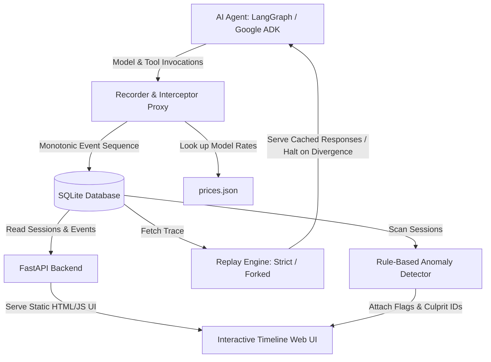

# ⚡ CS26048-AgentReplay

> **A logging proxy, observability timeline, and deterministic replay engine for AI agent tool and model calls.**

Developed as the practical implementation of **Project Proposal (24CS061)**.

## Project Documents

- [Problem Statement](docs/Problem-Statement.md)
- [Literature Survey](docs/Literature-Survey.md)
- [Project Timeline](docs/Project-Timeline.md)
- [Requirements](docs/Requirements.md)
- [Project Proposal](docs/PROPOSAL.md)
- [Architecture and implementation decisions](docs/DECISIONS.md)

---

## 🎯 The Problem

When conventional software fails, developers can attach debuggers, inspect stack traces, and step through execution lines. But in autonomous AI agents, the execution path is generated at runtime by stochastic LLMs and disappears after the request finishes. 

When an agent loops on a tool, quiet-fails after a malformed payload, or hallucinates an unexpected parameter, reproducing the issue is notoriously unreliable. Re-running the agent incurs network delays and API billing, and often takes an entirely different path.

`agent-replay` solves this gap:
1. **Records** every tool call and model call with timestamps, parameters, return values, token usage, and calculated cost.
2. **Reconstructs** sessions as an interactive, chronologically ordered visual timeline.
3. **Replays** past sessions **stochastically-free and with $0 API cost** by serving stored responses from SQLite.
4. **Forks** executions by substituting a recorded response at step $k$, allowing developers to observe how downstream model calls adapt to modified states.
5. **Detects** statistical irregularities (loops, cost spikes, runaway durations) with transparent, explainable rule-based detectors.

---

## 🏗️ Architecture



Model-call replay is implemented and validated for explicit model wrappers (the ADK-style loop). For LangGraph, model calls are recorded for audit/cost tracking but the live model is still called during replay; LangGraph model-call substitution is a known limitation, listed in Future Work.

---

## 📊 Core Data Schema

All interactions are captured in SQLite under the `events` table:

| Field | Type | Description |
| :--- | :--- | :--- |
| `session_id` | TEXT | Unique identifier grouping session events |
| `seq` | INTEGER | Monotonically increasing execution counter (1, 2, 3...) |
| `type` | TEXT | Event classification: `'tool_call'` or `'model_call'` |
| `name` | TEXT | Identifier (e.g. `search_docs`, `gemini-1.5-flash`) |
| `args_json` | TEXT | Full JSON serialized inputs / prompts |
| `result_json` | TEXT | Full JSON serialized outputs (NULL on failure) |
| `error` | TEXT | Traceback / error message if call failed |
| `started_at` | TEXT | UTC ISO-8601 timestamp |
| `duration_ms` | REAL | High-precision execution duration in milliseconds |
| `tokens_in` | INTEGER | Input / prompt token count |
| `tokens_out` | INTEGER | Output / candidate token count |
| `cost_usd` | REAL | Calculated cost when pricing and usage are known |
| `provider`, `model` | TEXT | Provider and resolved model, when available |
| `tokens_total`, `cached_tokens` | INTEGER | Usage totals and cached-token metadata, when reported |
| `cost_status` | TEXT | `actual`, `estimated`, or `unavailable` |

---

## 🚀 Quickstart

### 1. Prerequisites
- Python 3.11+ (Python 3.12 recommended)
- Git

### 2. Environment Setup
Clone the repository and activate the virtual environment:
```powershell
cd D:\agent-replay
.\.venv\Scripts\Activate.ps1
pip install -r requirements.txt
```

Provider-backed Playground calls are optional. Set only the provider key(s) you intend to use in
`.env`; keys are read server-side and are never stored in sessions or sent to the browser:
```env
GEMINI_API_KEY=AIzaSy...
DEFAULT_MODEL=gemini-2.0-flash
# OPENAI_API_KEY=
# ANTHROPIC_API_KEY=
```

The dashboard remains useful without any provider key: local recording, strict replay,
counterfactual experiments, timeline inspection, and analytics do not make paid network calls.
The AI Playground calls a provider only after the user submits a prompt. Provider responses and
prompts are recorded in the selected session for debugging, so do not submit secrets or personal
data. Usage and cost displays label unavailable pricing instead of treating it as zero.

Configure or customize token prices in `prices.json`:
```json
{
  "models": {
    "gemini-1.5-flash": {
      "input_cost_per_million": 0.075,
      "output_cost_per_million": 0.30
    }
  }
}
```

---

## 🎬 Running the Failure Scenarios & Replay Demos

### Scenario 1: Tool Looping & Rule-Based Detection
Run an agent stuck in a loop querying documentation with identical arguments:
```powershell
python scenarios/scenario_1_loop.py
```
**Outcome**:
- The session is recorded into SQLite.
- The `RepeatedToolCallsRule` flags the session with severity **DANGER**.
- Sequence IDs of the culprit loop steps are tagged and highlighted in the UI.

### Scenario 2: Strict Replay & Forked Substitution Recovery
Run an end-to-end failure, strict reproduction, and recovery test:
```powershell
python scenarios/scenario_2_malformed_response.py
```
**Outcome**:
1. **Baseline Failure**: The deterministic account tool returns an error payload and the workflow halts; the failed response is persisted in the timeline.
2. **Strict Runtime Replay**: Runs the decorated workflow against stored responses without invoking the underlying tool.
3. **Forked Runtime Execution**: Substitutes sequence #1 with valid account data (`{"status": "ok", "balance": 500.0}`), then executes the real downstream `calculate_credit` tool and persists a separate fork session.

To run the complete comparison through the UI, start the server and open the **Experiment** tab, then choose **Run experiment**. The result identifies the parent and fork sessions, outcomes, substituted event, and changed/added/removed events. Duration is the recorded local wall-clock timing for this synthetic scenario, not a provider performance benchmark. `POST /api/replay` remains trace validation only; it does not re-execute an agent workflow.

---

## 🌐 Interactive Timeline Web UI

Launch the FastAPI observability dashboard:
```powershell
uvicorn agent_replay.api:app --reload --host 127.0.0.1 --port 8000
```
Open your browser to: **[http://127.0.0.1:8000](http://127.0.0.1:8000)**

### Features:
- **Session Explorer**: Browse past sessions with start time, duration, and total USD cost.
- **Metric Cards**: Aggregate tokens, costs, durations, and tool vs model call ratios.
- **Flagged Badges**: Warning and Danger alert banners for anomaly sessions.
- **Chronological Timeline**: Step-by-step visual cards with duration badges, cost pills, and collapsible JSON payloads for both inputs and outputs.
- **Culprit Highlighting**: Cards identified by anomaly rules glow with red borders and `[FLAGGED]` pills.
- **Model Usage & Costs**: Filter recorded model usage by provider, model, and session. Costs are
  marked unavailable when token usage or an explicit model rate is missing.
- **AI Playground**: Exercise configured OpenAI, Anthropic, or Gemini adapters from the server,
  with failed provider calls recorded as failed sessions.

## ☁️ Vercel Deployment

The project includes a Vercel ASGI entrypoint in `api/index.py` and uses Turso for persistent serverless storage. Create a Turso database, then configure these Vercel environment variables for Production, Preview, and Development:

```text
TURSO_DATABASE_URL
TURSO_AUTH_TOKEN
GEMINI_API_KEY
DEFAULT_MODEL
USD_TO_INR
LIVE_RUN_ENABLED
CONFIG_MUTATIONS_ENABLED
```

Import `Deep1067/CS26048-AgentReplay` into Vercel with the repository root as the project directory. The first application startup creates the required sessions, events, and settings tables automatically. Pricing and detector settings are stored in the database when Turso is configured; local development continues to use SQLite and local configuration files.

`LIVE_RUN_ENABLED` and `CONFIG_MUTATIONS_ENABLED` default to `false`. Set them to `true` only in a trusted local environment; the application does not use a browser-visible shared secret for authorization. The deterministic scenarios can still be run directly with the commands above when live execution is disabled.

---

## 🧪 Running Automated Tests

Run the full unit and integration test suite:
```powershell
$env:PYTHONPATH = "src"
pytest -v
```

Run code formatting and linting:
```powershell
ruff check .
ruff format --check .
```
